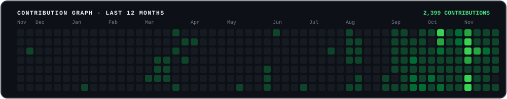
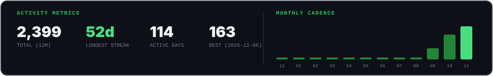
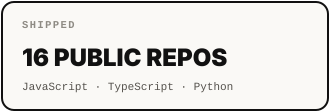
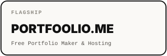
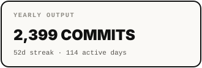
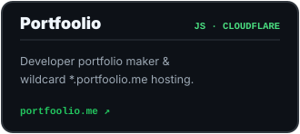
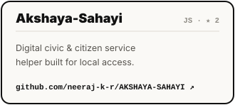
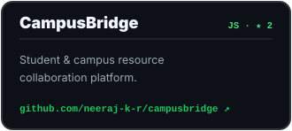
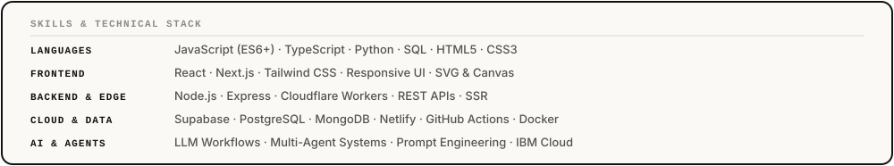

<!-- Every card is an animated SVG drawn by scripts/render_readme_cards.py from real
     GitHub data (scripts/fetch_contributions.py) and refreshed daily by
     .github/workflows/update-profile-art.yml. Design: paper white and ink black
     only, slim cards, dot portrait in the hero. Spacing is baked into the
     SVGs, so keep this block free of blank lines and keep the cards in a row on
     one line with no spaces between them. -->

 
 
 
 
 
 
  

