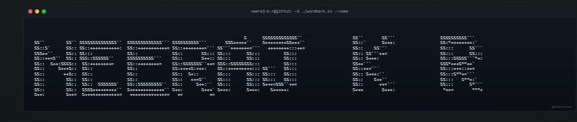
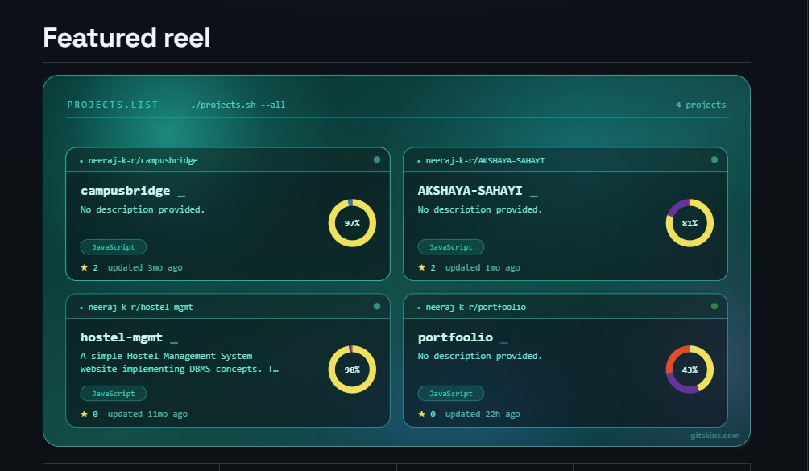

  <!-- Terminal Wordmark Header (Image 1) -->
  

   

  

    <strong>Neeraj K R</strong> · Frontend & Full-Stack Engineer
     
    Building modern web applications, intelligent agents, and interactive experiences.
  

  

    
    
    
  

---

<!-- Featured reel Section (Image 2) -->

  

---

## 🧰 Stack & Technologies

  

 

  

---

## 📊 By The Numbers

  

---

## 🟩 Contribution Activity

  

---

## 💬 Say Hello

  

 

  <code>neeraj-k-r@github:~$ exit 0</code>

