<div align="center">

  <!-- Terminal Wordmark Header (Image 1) -->
  <a href="https://github.com/neeraj-k-r">
    
  </a>

  <br/>

  <p align="center">
    <strong>Neeraj K R</strong> · Frontend & Full-Stack Engineer
    <br/>
    <sub>Building modern web applications, intelligent agents, and interactive experiences.</sub>
  </p>

  <p align="center">
    <a href="https://github.com/neeraj-k-r"></a>
    <a href="https://linkedin.com/in/neeraj-k-r"></a>
    <a href="mailto:neeraj.k.r@example.com"></a>
  </p>

</div>

---

### 💻 `neeraj-k-r@github:~$ whoami --verbose`

```yaml
name: Neeraj K R
role: Frontend & Full-Stack Developer
focus: Modern JavaScript/TypeScript ecosystems, Agentic AI, and scalable web apps
current_status: Shipping open-source projects & exploring agent architectures
learning: Cloud-native workflows, LLM orchestration, and modern UX design
```

---

## 🎬 Featured reel

<div align="center">
  <!-- Projects Reel (Image 2) -->
  <a href="https://github.com/neeraj-k-r?tab=repositories">
    
  </a>
</div>

<br/>

<details open>
<summary><b>📦 Project Repository Index</b></summary>

<br/>

| Project | Description | Tech Stack | Stars |
| :--- | :--- | :--- | :---: |
| 🎓 **[campusbridge](https://github.com/neeraj-k-r/campusbridge)** | Campus collaboration and student management platform | `JavaScript` `Web` | ★ 2 |
| 🏛️ **[AKSHAYA-SAHAYI](https://github.com/neeraj-k-r/AKSHAYA-SAHAYI)** | Citizen-first service utility and governance assistant portal | `JavaScript` `Full-Stack` | ★ 2 |
| 🤖 **[Agentic-AI-Interview-Trainer](https://github.com/neeraj-k-r/Agentic-AI-Interview-Trainer)** | AI mock interview trainer with agent feedback powered by IBM Cloud | `AI / Agents` `Cloud` | ★ 1 |
| 📈 **[smart-leads-dashboard](https://github.com/neeraj-k-r/smart-leads-dashboard)** | Interactive analytics dashboard for sales leads conversion | `JavaScript` `Analytics` | ★ 1 |
| 🏨 **[hostel-mgmt](https://github.com/neeraj-k-r/hostel-mgmt)** | Hostel Management System demonstrating relational DBMS concepts | `JavaScript` `SQL / DBMS` | ★ 0 |
| 💼 **[portfoolio](https://github.com/neeraj-k-r/portfoolio)** | Responsive developer portfolio showcase | `JavaScript` `CSS3` | ★ 0 |
| 🛠️ **[KODEFIX](https://github.com/neeraj-k-r/KODEFIX)** | Code diagnostic and rapid developer bug fixing utility | `JavaScript` `Tools` | ★ 1 |

</details>

---

## 🧰 Stack & Technologies

<div align="center">
  
</div>

<br/>

<p align="center">
  
</p>

---

## 📊 By The Numbers

<div align="center">
  
</div>

---

## 🟩 Contribution Activity

<div align="center">
  
</div>

---

## 💬 Say Hello

<div align="center">
  
</div>

<br/>

<div align="center">
  <sub><code>neeraj-k-r@github:~$ exit 0</code></sub>
</div>

